# MATRICE — aperçu du prototype UX/UI (V8.1)

Aperçu statique, lisible sans JavaScript : captures Mac (1440 × 900) et iPhone (393 × 852) de chaque écran, puis le texte affiché.
Données fictives. Branche `ux/refonte-uxui`, commit `a99570a`, généré le 28/11/2026 16:17:02.
Prototype interactif : https://claude.ai/artifact/4bEGUsBscbkLQj9jM5CMpE · Code : https://github.com/Antcb/lartbo-matrice/tree/ux/refonte-uxui/prototype-ux

## Écrans
- [Tableau de bord](#01-tableau-de-bord) — [Mac](01-tableau-de-bord-mac.jpg) · [iPhone](01-tableau-de-bord-iphone.jpg)
- [Booking — tableau (regroupé par mois)](#02-booking-tableau) — [Mac](02-booking-tableau-mac.jpg) · [iPhone](02-booking-tableau-iphone.jpg)
- [Booking — regroupé par artiste puis mois](#03-booking-artiste-mois) — [Mac](03-booking-artiste-mois-mac.jpg) · [iPhone](03-booking-artiste-mois-iphone.jpg)
- [Booking — fiche d’une date (Le Moulin)](#04-booking-fiche) — [Mac](04-booking-fiche-mac.jpg) · [iPhone](04-booking-fiche-iphone.jpg)
- [Booking — carte et trajets](#05-booking-carte) — [Mac](05-booking-carte-mac.jpg) · [iPhone](05-booking-carte-iphone.jpg)
- [Suivi — liste](#06-suivi-liste) — [Mac](06-suivi-liste-mac.jpg) · [iPhone](06-suivi-liste-iphone.jpg)
- [Suivi — espace de prospection (La Cale Sèche) : échanges](#07-suivi-fiche) — [Mac](07-suivi-fiche-mac.jpg) · [iPhone](07-suivi-fiche-iphone.jpg)
- [Suivi — espace de prospection : dates, négociation, carte, planning](#08-suivi-dates) — [Mac](08-suivi-dates-mac.jpg) · [iPhone](08-suivi-dates-iphone.jpg)
- [Préférences](#09-preferences) — [Mac](09-preferences-mac.jpg) · [iPhone](09-preferences-iphone.jpg)

<a id="01-tableau-de-bord"></a>
## Tableau de bord

| Mac | iPhone |
|---|---|
| 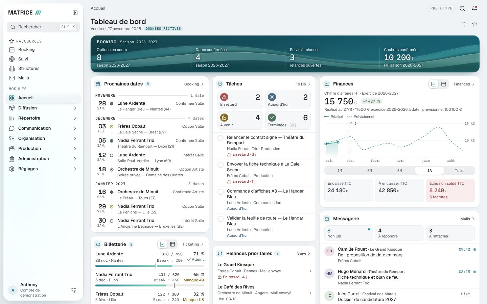 | 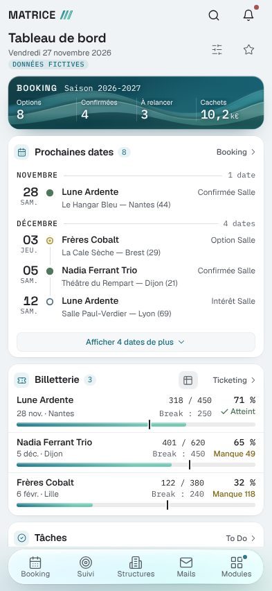 |

<details><summary>Texte de l’écran (Mac)</summary>

```text
Tableau de bord

Vendredi 27 novembre 2026
DONNÉES FICTIVES

BOOKING
Saison 2026-2027
Options en cours
8
saison 2026-2027
Dates confirmées
4
saison 2026-2027
Suivis à relancer
3
relances ouvertes
Cachets confirmés
10 200€
HT, saison 2026-2027
Prochaines dates
8
Booking
NOVEMBRE
1 date
28
SAM.
Lune Ardente
Confirmée Salle
Le Hangar Bleu — Nantes (44)
DÉCEMBRE
4 dates
03
JEU.
Frères Cobalt
Option Salle
La Cale Sèche — Brest (29)
05
SAM.
Nadia Ferrant Trio
Confirmée Salle
Théâtre du Rempart — Dijon (21)
12
SAM.
Lune Ardente
Intérêt Salle
Salle Paul-Verdier — Lyon (69)
18
VEN.
Orchestre de Minuit
Option Artiste
Soirée privée — Domaine des Cèdres —
JANVIER 2027
3 dates
16
SAM.
Orchestre de Minuit
Confirmée Artiste
Le Préau — Tours (37)
29
VEN.
Nadia Ferrant Trio
Option Salle
La Péniche — Lille (59)
30
SAM.
Nadia Ferrant Trio
Intérêt Salle
L’Ancienne Belgique — Bruxelles (BE)
Billetterie
3
Ticketing
Lune Ardente
318 / 450
71 %
28 nov. · Nantes
Break : 250
Atteint
Nadia Ferrant Trio
401 / 620
65 %
5 déc. · Dijon
Break : 450
Manque 49
Frères Cobalt
122 / 380
32 %
6 févr. · Lille
Break : 240
Manque 118
Tâches
To Do
2
En retard
2
Aujourd’hui
4
À venir
6
Terminées · 30 j
ces 30 derniers jours
Relancer le contrat signé — Théâtre du Rempart
Nadia Ferrant Trio · Production
En retard · 3 j
Envoyer la fiche technique à La Cale Sèche
Frères Cobalt · Production
En retard · 1 j
Commande d’affiches A3 — Le Hangar Bleu
Lune Ardente · Communication
Aujourd’hui
Valider la feuille de route — Le Hangar Bleu
Lune Ardente · Production
Aujourd’hui
Relances prioritaires
3
Suivi
Le Grand Kiosque
Frères Cobalt · Rennes · Mail envoyé
En retard · 4 j
Le Café des Rives
Orchestre de Minuit · Angers · Mail envoyé
Jeu. 03/12
Opéra de Limoges
Orchestre de Minuit · Limoges · Intérêt
Lun. 07/12
Suivis actifs
Suivi

11
suivis actifs, hors confirmés et clos

3
Mail envoyé
4
Intérêt
4
Option
Finances
Finances
Chiffre d’affaires HT · Exercice 2026-2027
15 750€
+37 %
Réalisé au 27/11 · 11 500 € exercice 2025-2026 à date · prévisionnel 103 100 €

Réalisé
Prévisionnel

10 k€
19 k€
auj.
oct.
déc.
févr.
avr.
juin
août
1M
3M
6M
1A
Tout
Encaissé TTC
24 180€
À encaisser TTC
42 850€
Échu non soldé TTC
8 240€
5 factures
, compris dans le montant à encaisser
Messagerie
Mails
8
Non lus
4
À répondre
3
À rattacher
CR
Camille Rouet · Le Grand Kiosque
09:42
Re : proposition de date en mars
Frères Cobalt
Non lu
HM
Hugo Ménard · Théâtre du Rempart
08:15
Fiche technique et plan de feu
Nadia Ferrant Trio
Non lu
IC
Inès Carrel · Festival des Marais
Hier
Dossier de candidature 2027
Lune Ardente
PT
Paul Ternier · Le Hangar Bleu
Hier
Acompte réglé
Lune Ardente
LF
Léa Fournel · La Fabrique Sonore
mer.
Boucle communication : visuels reçus
Frères Cobalt
```
</details>

<a id="02-booking-tableau"></a>
## Booking — tableau (regroupé par mois)

| Mac | iPhone |
|---|---|
| 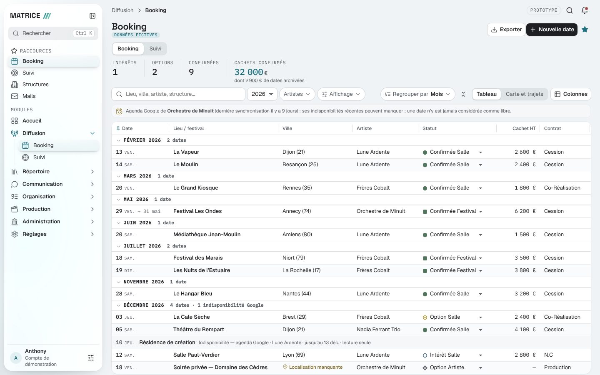 | 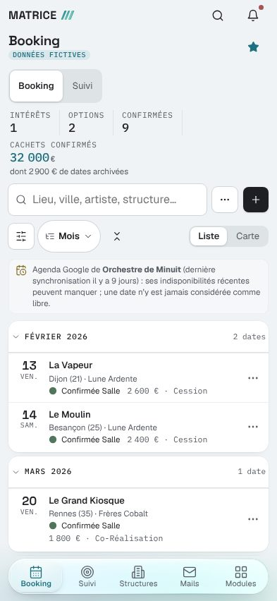 |

<details><summary>Texte de l’écran (Mac)</summary>

```text
Booking

DONNÉES FICTIVES

Exporter
Nouvelle date
Booking
Suivi
INTÉRÊTS
1
OPTIONS
2
CONFIRMÉES
9
CACHETS CONFIRMÉS
32 000€
dont 2 900 € de dates archivées
2025
2026
2027
2028
Artistes
Affichage
Regrouper par
Mois
Tableau
Carte et trajets
Colonnes

Agenda Google de Orchestre de Minuit (dernière synchronisation il y a 9 jours) : ses indisponibilités récentes peuvent manquer ; une date n’y est jamais considérée comme libre.

Date
	
Lieu / festival
	
Ville
	
Artiste
	
Statut
	
Cachet HT
	
Contrat
	
Trajet

FÉVRIER 2026
2 dates

13
VEN.
	La Vapeur	Dijon (21)	Lune Ardente	
Intérêt Festival
Option Festival
Confirmée Festival
Intérêt Salle
Option Salle
Confirmée Salle
Option Artiste
Confirmée Artiste
Annulée
Sans Suite
Sans statut
	2 600 €	Cession	
A
B

14
SAM.
	Le Moulin	Besançon (25)	Lune Ardente	
Intérêt Festival
Option Festival
Confirmée Festival
Intérêt Salle
Option Salle
Confirmée Salle
Option Artiste
Confirmée Artiste
Annulée
Sans Suite
Sans statut
	2 400 €	Cession	
A
B

MARS 2026
1 date

20
VEN.
	Le Grand Kiosque	Rennes (35)	Frères Cobalt	
Intérêt Festival
Option Festival
Confirmée Festival
Intérêt Salle
Option Salle
Confirmée Salle
Option Artiste
Confirmée Artiste
Annulée
Sans Suite
Sans statut
	1 800 €	Co-Réalisation	
A
B

MAI 2026
1 date

29
VEN.
→ 31 mai	Festival Les Ondes	Annecy (74)	Orchestre de Minuit	
Intérêt Festival
Option Festival
Confirmée Festival
Intérêt Salle
Option Salle
Confirmée Salle
Option Artiste
Confirmée Artiste
Annulée
Sans Suite
Sans statut
	6 200 €	Cession	
A
B

JUIN 2026
1 date

20
SAM.
	Médiathèque Jean-Moulin	Amiens (80)	Lune Ardente	
Intérêt Festival
Option Festival
Confirmée Festival
Intérêt Salle
Option Salle
Confirmée Salle
Option Artiste
Confirmée Artiste
Annulée
Sans Suite
Sans statut
	1 500 €	Cession	
A
B

JUILLET 2026
2 dates

18
SAM.
	Festival des Marais	Niort (79)	Frères Cobalt	
Intérêt Festival
Option Festival
Confirmée Festival
Intérêt Salle
Option Salle
Confirmée Salle
Option Artiste
Confirmée Artiste
Annulée
Sans Suite
Sans statut
	3 500 €	Cession	
A
B

19
DIM.
	Les Nuits de l’Estuaire	La Rochelle (17)	Frères Cobalt	
Intérêt Festival
Option Festival
Confirmée Festival
Intérêt Salle
Option Salle
Confirmée Salle
Option Artiste
Confirmée Artiste
Annulée
Sans Suite
Sans statut
	3 800 €	Cession	
A
B

NOVEMBRE 2026
1 date

28
SAM.
	Le Hangar Bleu	Nantes (44)	Lune Ardente	
Intérêt Festival
Option Festival
Confirmée Festival
Intérêt Salle
Option Salle
Confirmée Salle
Option Artiste
Confirmée Artiste
Annulée
Sans Suite
Sans statut
	3 200 €	Cession	
A
B

DÉCEMBRE 2026
4 dates · 1 indisponibilité Google

03
JEU.
	La Cale Sèche	Brest (29)	Frères Cobalt	
Intérêt Festival
Option Festival
Confirmée Festival
Intérêt Salle
Option Salle
Confirmée Salle
Option Artiste
Confirmée Artiste
Annulée
Sans Suite
Sans statut
	2 400 €	Co-Réalisation	
A
B

05
SAM.
	Théâtre du Rempart	Dijon (21)	Nadia Ferrant Trio	
Intérêt Festival
Option Festival
Confirmée Festival
Intérêt Salle
Option Salle
Confirmée Salle
Option Artiste
Confirmée Artiste
Annulée
Sans Suite
Sans statut
	4 100 €	Cession	
A
B

10
JEU.
Résidence de création
Indisponibilité — agenda Google · Lune Ardente · jusqu’au 13 déc. · lecture seule
Google

12
SAM.
	Salle Paul-Verdier	Lyon (69)	Lune Ardente	
Intérêt Festival
Option Festival
Confirmée Festival
Intérêt Salle
Option Salle
Confirmée Salle
Option Artiste
Confirmée Artiste
Annulée
Sans Suite
Sans statut
	2 800 €	N.C	
A
B

18
VEN.
	Soirée privée — Domaine des Cèdres	
Localisation manquante	Orchestre de Minuit	
Intérêt Festival
Option Festival
Confirmée Festival
Intérêt Salle
Option Salle
Confirmée Salle
Option Artiste
Confirmée Artiste
Annulée
Sans Suite
Sans statut
	—	Production	
A
B
```
</details>

<a id="03-booking-artiste-mois"></a>
## Booking — regroupé par artiste puis mois

| Mac | iPhone |
|---|---|
| 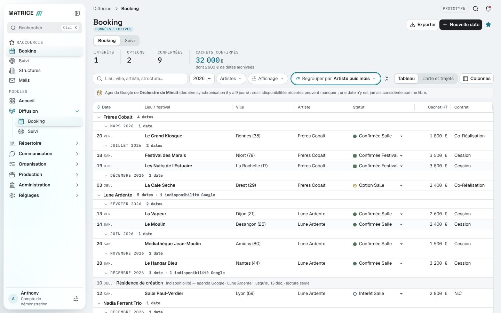 | 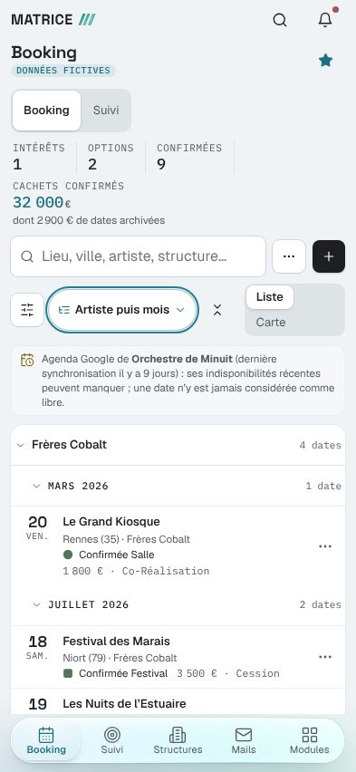 |

<details><summary>Texte de l’écran (Mac)</summary>

```text
Booking

DONNÉES FICTIVES

Exporter
Nouvelle date
Booking
Suivi
INTÉRÊTS
1
OPTIONS
2
CONFIRMÉES
9
CACHETS CONFIRMÉS
32 000€
dont 2 900 € de dates archivées
2025
2026
2027
2028
Artistes
Affichage
Regrouper par
Artiste puis mois
Tableau
Carte et trajets
Colonnes

Agenda Google de Orchestre de Minuit (dernière synchronisation il y a 9 jours) : ses indisponibilités récentes peuvent manquer ; une date n’y est jamais considérée comme libre.

Date
	
Lieu / festival
	
Ville
	
Artiste
	
Statut
	
Cachet HT
	
Contrat
	
Trajet

Frères Cobalt
4 dates

MARS 2026
1 date

20
VEN.
	Le Grand Kiosque	Rennes (35)	Frères Cobalt	
Intérêt Festival
Option Festival
Confirmée Festival
Intérêt Salle
Option Salle
Confirmée Salle
Option Artiste
Confirmée Artiste
Annulée
Sans Suite
Sans statut
	1 800 €	Co-Réalisation	
A
B

JUILLET 2026
2 dates

18
SAM.
	Festival des Marais	Niort (79)	Frères Cobalt	
Intérêt Festival
Option Festival
Confirmée Festival
Intérêt Salle
Option Salle
Confirmée Salle
Option Artiste
Confirmée Artiste
Annulée
Sans Suite
Sans statut
	3 500 €	Cession	
A
B

19
DIM.
	Les Nuits de l’Estuaire	La Rochelle (17)	Frères Cobalt	
Intérêt Festival
Option Festival
Confirmée Festival
Intérêt Salle
Option Salle
Confirmée Salle
Option Artiste
Confirmée Artiste
Annulée
Sans Suite
Sans statut
	3 800 €	Cession	
A
B

DÉCEMBRE 2026
1 date

03
JEU.
	La Cale Sèche	Brest (29)	Frères Cobalt	
Intérêt Festival
Option Festival
Confirmée Festival
Intérêt Salle
Option Salle
Confirmée Salle
Option Artiste
Confirmée Artiste
Annulée
Sans Suite
Sans statut
	2 400 €	Co-Réalisation	
A
B

Lune Ardente
5 dates · 1 indisponibilité Google

FÉVRIER 2026
2 dates

13
VEN.
	La Vapeur	Dijon (21)	Lune Ardente	
Intérêt Festival
Option Festival
Confirmée Festival
Intérêt Salle
Option Salle
Confirmée Salle
Option Artiste
Confirmée Artiste
Annulée
Sans Suite
Sans statut
	2 600 €	Cession	
A
B

14
SAM.
	Le Moulin	Besançon (25)	Lune Ardente	
Intérêt Festival
Option Festival
Confirmée Festival
Intérêt Salle
Option Salle
Confirmée Salle
Option Artiste
Confirmée Artiste
Annulée
Sans Suite
Sans statut
	2 400 €	Cession	
A
B

JUIN 2026
1 date

20
SAM.
	Médiathèque Jean-Moulin	Amiens (80)	Lune Ardente	
Intérêt Festival
Option Festival
Confirmée Festival
Intérêt Salle
Option Salle
Confirmée Salle
Option Artiste
Confirmée Artiste
Annulée
Sans Suite
Sans statut
	1 500 €	Cession	
A
B

NOVEMBRE 2026
1 date

28
SAM.
	Le Hangar Bleu	Nantes (44)	Lune Ardente	
Intérêt Festival
Option Festival
Confirmée Festival
Intérêt Salle
Option Salle
Confirmée Salle
Option Artiste
Confirmée Artiste
Annulée
Sans Suite
Sans statut
	3 200 €	Cession	
A
B

DÉCEMBRE 2026
1 date · 1 indisponibilité Google

10
JEU.
Résidence de création
Indisponibilité — agenda Google · Lune Ardente · jusqu’au 13 déc. · lecture seule
Google

12
SAM.
	Salle Paul-Verdier	Lyon (69)	Lune Ardente	
Intérêt Festival
Option Festival
Confirmée Festival
Intérêt Salle
Option Salle
Confirmée Salle
Option Artiste
Confirmée Artiste
Annulée
Sans Suite
Sans statut
	2 800 €	N.C	
A
B

Nadia Ferrant Trio
1 date

DÉCEMBRE 2026
1 date

05
SAM.
	Théâtre du Rempart	Dijon (21)	Nadia Ferrant Trio	
Intérêt Festival
Option Festival
Confirmée Festival
Intérêt Salle
Option Salle
Confirmée Salle
Option Artiste
Confirmée Artiste
Annulée
Sans Suite
Sans statut
	4 100 €	Cession	
A
B

Orchestre de Minuit
2 dates

MAI 2026
1 date

29
VEN.
→ 31 mai	Festival Les Ondes	Annecy (74)	Orchestre de Minuit	
Intérêt Festival
Option Festival
Confirmée Festival
Intérêt Salle
Option Salle
Confirmée Salle
Option Artiste
Confirmée Artiste
Annulée
Sans Suite
Sans statut
	6 200 €	Cession	
A
B

DÉCEMBRE 2026
1 date

18
VEN.
	Soirée privée — Domaine des Cèdres	
Localisation manquante	Orchestre de Minuit	
Intérêt Festival
Option Festival
Confirmée Festival
Intérêt Salle
Option Salle
Confirmée Salle
Option Artiste
Confirmée Artiste
Annulée
Sans Suite
Sans statut
	—	Production	
A
B
```
</details>

<a id="04-booking-fiche"></a>
## Booking — fiche d’une date (Le Moulin)

| Mac | iPhone |
|---|---|
| 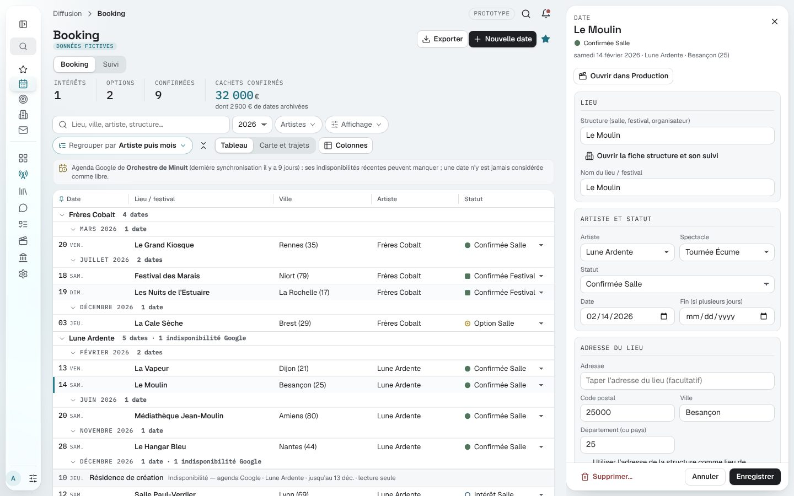 | 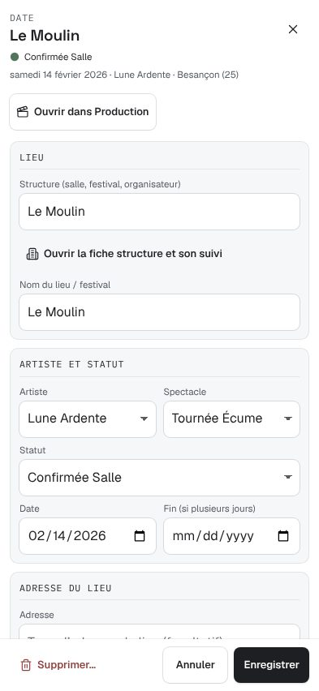 |

<details><summary>Texte de l’écran (Mac)</summary>

```text
Booking

DONNÉES FICTIVES

Exporter
Nouvelle date
Booking
Suivi
INTÉRÊTS
1
OPTIONS
2
CONFIRMÉES
9
CACHETS CONFIRMÉS
32 000€
dont 2 900 € de dates archivées
2025
2026
2027
2028
Artistes
Affichage
Regrouper par
Artiste puis mois
Tableau
Carte et trajets
Colonnes

Agenda Google de Orchestre de Minuit (dernière synchronisation il y a 9 jours) : ses indisponibilités récentes peuvent manquer ; une date n’y est jamais considérée comme libre.

Date
	
Lieu / festival
	
Ville
	
Artiste
	
Statut
	
Cachet HT
	
Contrat
	
Trajet

Frères Cobalt
4 dates

MARS 2026
1 date

20
VEN.
	Le Grand Kiosque	Rennes (35)	Frères Cobalt	
Intérêt Festival
Option Festival
Confirmée Festival
Intérêt Salle
Option Salle
Confirmée Salle
Option Artiste
Confirmée Artiste
Annulée
Sans Suite
Sans statut
	1 800 €	Co-Réalisation	
A
B

JUILLET 2026
2 dates

18
SAM.
	Festival des Marais	Niort (79)	Frères Cobalt	
Intérêt Festival
Option Festival
Confirmée Festival
Intérêt Salle
Option Salle
Confirmée Salle
Option Artiste
Confirmée Artiste
Annulée
Sans Suite
Sans statut
	3 500 €	Cession	
A
B

19
DIM.
	Les Nuits de l’Estuaire	La Rochelle (17)	Frères Cobalt	
Intérêt Festival
Option Festival
Confirmée Festival
Intérêt Salle
Option Salle
Confirmée Salle
Option Artiste
Confirmée Artiste
Annulée
Sans Suite
Sans statut
	3 800 €	Cession	
A
B

DÉCEMBRE 2026
1 date

03
JEU.
	La Cale Sèche	Brest (29)	Frères Cobalt	
Intérêt Festival
Option Festival
Confirmée Festival
Intérêt Salle
Option Salle
Confirmée Salle
Option Artiste
Confirmée Artiste
Annulée
Sans Suite
Sans statut
	2 400 €	Co-Réalisation	
A
B

Lune Ardente
5 dates · 1 indisponibilité Google

FÉVRIER 2026
2 dates

13
VEN.
	La Vapeur	Dijon (21)	Lune Ardente	
Intérêt Festival
Option Festival
Confirmée Festival
Intérêt Salle
Option Salle
Confirmée Salle
Option Artiste
Confirmée Artiste
Annulée
Sans Suite
Sans statut
	2 600 €	Cession	
A
B

14
SAM.
	Le Moulin	Besançon (25)	Lune Ardente	
Intérêt Festival
Option Festival
Confirmée Festival
Intérêt Salle
Option Salle
Confirmée Salle
Option Artiste
Confirmée Artiste
Annulée
Sans Suite
Sans statut
	2 400 €	Cession	
A
B

JUIN 2026
1 date

20
SAM.
	Médiathèque Jean-Moulin	Amiens (80)	Lune Ardente	
Intérêt Festival
Option Festival
Confirmée Festival
Intérêt Salle
Option Salle
Confirmée Salle
Option Artiste
Confirmée Artiste
Annulée
Sans Suite
Sans statut
	1 500 €	Cession	
A
B

NOVEMBRE 2026
1 date

28
SAM.
	Le Hangar Bleu	Nantes (44)	Lune Ardente	
Intérêt Festival
Option Festival
Confirmée Festival
Intérêt Salle
Option Salle
Confirmée Salle
Option Artiste
Confirmée Artiste
Annulée
Sans Suite
Sans statut
	3 200 €	Cession	
A
B

DÉCEMBRE 2026
1 date · 1 indisponibilité Google

10
JEU.
Résidence de création
Indisponibilité — agenda Google · Lune Ardente · jusqu’au 13 déc. · lecture seule
Google

12
SAM.
	Salle Paul-Verdier	Lyon (69)	Lune Ardente	
Intérêt Festival
Option Festival
Confirmée Festival
Intérêt Salle
Option Salle
Confirmée Salle
Option Artiste
Confirmée Artiste
Annulée
Sans Suite
Sans statut
	2 800 €	N.C	
A
B

Nadia Ferrant Trio
1 date

DÉCEMBRE 2026
1 date

05
SAM.
	Théâtre du Rempart	Dijon (21)	Nadia Ferrant Trio	
Intérêt Festival
Option Festival
Confirmée Festival
Intérêt Salle
Option Salle
Confirmée Salle
Option Artiste
Confirmée Artiste
Annulée
Sans Suite
Sans statut
	4 100 €	Cession	
A
B

Orchestre de Minuit
2 dates

MAI 2026
1 date

29
VEN.
→ 31 mai	Festival Les Ondes	Annecy (74)	Orchestre de Minuit	
Intérêt Festival
Option Festival
Confirmée Festival
Intérêt Salle
Option Salle
Confirmée Salle
Option Artiste
Confirmée Artiste
Annulée
Sans Suite
Sans statut
	6 200 €	Cession	
A
B

DÉCEMBRE 2026
1 date

18
VEN.
	Soirée privée — Domaine des Cèdres	
Localisation manquante	Orchestre de Minuit	
Intérêt Festival
Option Festival
Confirmée Festival
Intérêt Salle
Option Salle
Confirmée Salle
Option Artiste
Confirmée Artiste
Annulée
Sans Suite
Sans statut
	—	Production	
A
B

--- Panneau ouvert ---
DATE
Le Moulin
Confirmée Salle
samedi 14 février 2026 · Lune Ardente · Besançon (25)
Ouvrir dans Production
LIEU
Structure (salle, festival, organisateur)
Ouvrir la fiche structure et son suivi
Nom du lieu / festival
ARTISTE ET STATUT
Artiste
— choisir l’artiste —
Lune Ardente
Frères Cobalt
Nadia Ferrant Trio
Orchestre de Minuit
Spectacle
— choisir le spectacle —
Tournée Écume
Jeune public
Statut
Intérêt Festival
Option Festival
Confirmée Festival
Intérêt Salle
Option Salle
Confirmée Salle
Option Artiste
Confirmée Artiste
Annulée
Sans Suite
Sans statut
Date
Fin (si plusieurs jours)
ADRESSE DU LIEU
Adresse
Code postal
Ville
Département (ou pays)
Utiliser l’adresse de la structure comme lieu de représentation

Sans lieu choisi, adresse propre ou cette case, l’adresse, le code postal et la ville du lieu restent à compléter dans la fiche, le contrat et les mails.

CONTRAT ET BILLETTERIE
Type de contrat
—
Cession
Co-Réalisation
Production
Co-Production
N.C
Cachet HT (€)
Billetterie
—
Payant/Prix Libre
Gratuit
Jauge
Date de la demande
Concernée par le ticketing
Concernée par la communication
NOTES
Notes
Dossier Drive de la date
Ouvrir
Supprimer…
Annuler
Enregistrer
```
</details>

<a id="05-booking-carte"></a>
## Booking — carte et trajets

| Mac | iPhone |
|---|---|
| 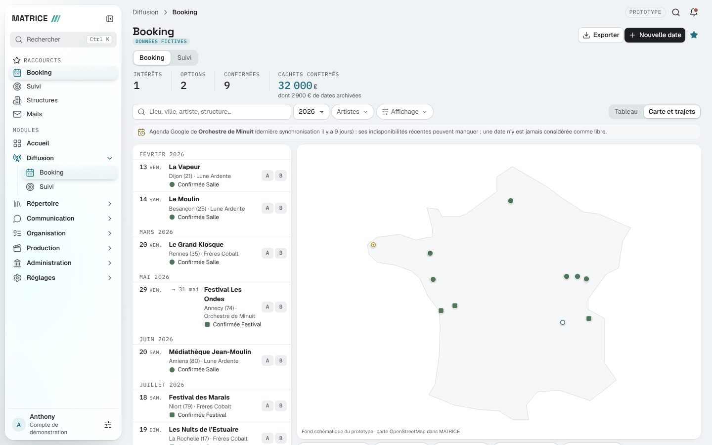 | 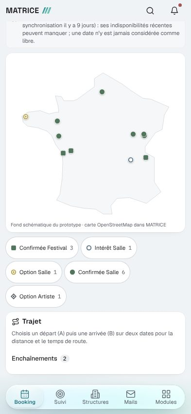 |

<details><summary>Texte de l’écran (Mac)</summary>

```text
Booking

DONNÉES FICTIVES

Exporter
Nouvelle date
Booking
Suivi
INTÉRÊTS
1
OPTIONS
2
CONFIRMÉES
9
CACHETS CONFIRMÉS
32 000€
dont 2 900 € de dates archivées
2025
2026
2027
2028
Artistes
Affichage
Tableau
Carte et trajets

Agenda Google de Orchestre de Minuit (dernière synchronisation il y a 9 jours) : ses indisponibilités récentes peuvent manquer ; une date n’y est jamais considérée comme libre.

FÉVRIER 2026

13
VEN.
La Vapeur
Dijon (21) · Lune Ardente
Confirmée Salle
A
B
14
SAM.
Le Moulin
Besançon (25) · Lune Ardente
Confirmée Salle
A
B

MARS 2026

20
VEN.
Le Grand Kiosque
Rennes (35) · Frères Cobalt
Confirmée Salle
A
B

MAI 2026

29
VEN.
→ 31 mai
Festival Les Ondes
Annecy (74) · Orchestre de Minuit
Confirmée Festival
A
B

JUIN 2026

20
SAM.
Médiathèque Jean-Moulin
Amiens (80) · Lune Ardente
Confirmée Salle
A
B

JUILLET 2026

18
SAM.
Festival des Marais
Niort (79) · Frères Cobalt
Confirmée Festival
A
B
19
DIM.
Les Nuits de l’Estuaire
La Rochelle (17) · Frères Cobalt
Confirmée Festival
A
B

NOVEMBRE 2026

28
SAM.
Le Hangar Bleu
Nantes (44) · Lune Ardente
Confirmée Salle
A
B

DÉCEMBRE 2026

03
JEU.
La Cale Sèche
Brest (29) · Frères Cobalt
Option Salle
A
B
05
SAM.
Théâtre du Rempart
Dijon (21) · Nadia Ferrant Trio
Confirmée Salle
A
B
12
SAM.
Salle Paul-Verdier
Lyon (69) · Lune Ardente
Intérêt Salle
A
B
18
VEN.
Soirée privée — Domaine des Cèdres
Localisation manquante · Orchestre de Minuit
Option Artiste
A
B
Fond schématique du prototype · carte OpenStreetMap dans MATRICE
Confirmée Festival
3
Intérêt Salle
1
Option Salle
1
Confirmée Salle
6
Option Artiste
1
Trajet

Choisis un départ (A) puis une arrivée (B) sur deux dates pour la distance et le temps de route.

Enchaînements
2
```
</details>

<a id="06-suivi-liste"></a>
## Suivi — liste

| Mac | iPhone |
|---|---|
| 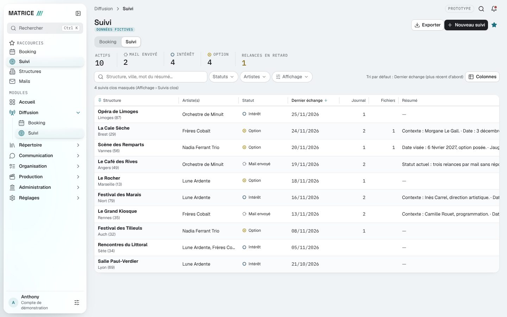 | 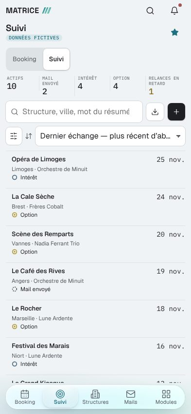 |

<details><summary>Texte de l’écran (Mac)</summary>

```text
Suivi

DONNÉES FICTIVES

Exporter
Nouveau suivi
Booking
Suivi
ACTIFS
10
MAIL ENVOYÉ
2
INTÉRÊT
4
OPTION
4
RELANCES EN RETARD
1
Statuts
Artistes
Affichage
Tri par défaut : Dernier échange (plus récent d’abord)
Colonnes

4 suivis clos masqués (Affichage › Suivis clos)

Structure
	
Artiste(s)
	
Statut
	
Dernier échange
	
Journal
	
Fichiers
	
Résumé

Opéra de Limoges
Limoges (87)
	Orchestre de Minuit	
Intérêt
	25/11/2026	1		—

La Cale Sèche
Brest (29)
	Frères Cobalt	
Option
	24/11/2026	2	1	Contexte : Morgane Le Gall. · Date : 3 décembre 2026 en option. · Offre financière : co-réalisation, minimum garanti 2 400 € HT. · Accueil : catering et hébergement pris en charge. · Prochaine action : confirmation attendue.

Scène des Remparts
Vannes (56)
	Nadia Ferrant Trio	
Option
	20/11/2026	1	1	Date visée : 6 février 2027, option posée. · Jauge : 280 places, billetterie payante. · Prochaine action : retour budget avant le 30/11.

Le Café des Rives
Angers (49)
	Orchestre de Minuit	
Mail envoyé
	19/11/2026	2		Statut actuel : trois relances par mail sans réponse. · Prochaine action : appel le 03/12.

Le Rocher
Marseille (13)
	Lune Ardente	
Option
	18/11/2026	1		—

Festival des Marais
Niort (79)
	Lune Ardente	
Intérêt
	16/11/2026	2		Contexte : Inès Carrel, direction artistique. · Date visée : juillet 2027. · Offre financière : à préciser (cession). · Prochaine action : rappeler le 26/11.

Le Grand Kiosque
Rennes (35)
	Frères Cobalt	
Mail envoyé
	13/11/2026	2		Contexte : Camille Rouet, programmation. · Date visée : mars 2027, week-end. · Statut actuel : relance n°1 envoyée le 13/11. · Prochaine action : relance le 23/11.

Festival des Tilleuls
Auch (32)
	Nadia Ferrant Trio	
Option
	08/11/2026	1		—

Rencontres du Littoral
Sète (34)
	Lune Ardente, Frères Cobalt	
Intérêt
	05/11/2026			—

Salle Paul-Verdier
Lyon (69)
	Lune Ardente	
Intérêt
	21/10/2026			—
```
</details>

<a id="07-suivi-fiche"></a>
## Suivi — espace de prospection (La Cale Sèche) : échanges

| Mac | iPhone |
|---|---|
| 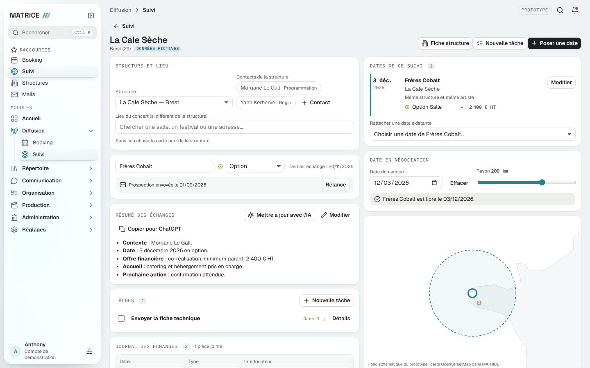 | 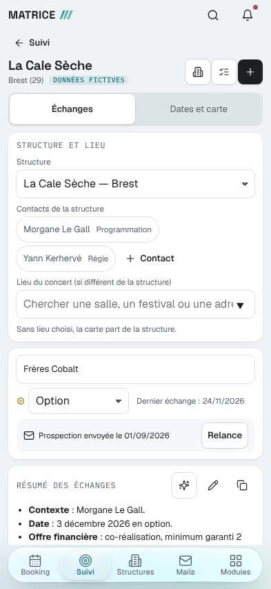 |

<details><summary>Texte de l’écran (Mac)</summary>

```text
Suivi
La Cale Sèche

Brest (29)
DONNÉES FICTIVES

Fiche structure
Nouvelle tâche
Poser une date
STRUCTURE ET LIEU
Structure
Choisir la structure…
Association Ondes Vives — Annecy
Festival des Marais — Niort
Festival des Tilleuls — Auch
La Cale Sèche — Brest
La Fabrique Sonore — Lille
La Vapeur — Dijon
Le Café des Rives — Angers
Le Grand Kiosque — Rennes
Le Hangar Bleu — Nantes
Le Moulin — Besançon
Le Préau — Tours
Le Rocher — Marseille
Opéra de Limoges — Limoges
Rencontres du Littoral — Sète
Salle Paul-Verdier — Lyon
Scène des Remparts — Vannes
Théâtre du Rempart — Dijon
Ville de Poitiers — service culture — Poitiers
Contacts de la structure
Morgane Le Gall
Programmation
Yann Kerhervé
Régie
Contact
Lieu du concert (si différent de la structure)

Sans lieu choisi, la carte part de la structure.

Frères Cobalt
Statut du suivi
Mail envoyé
Intérêt
Option
Confirmé
Clos
Dernier échange : 24/11/2026

Prospection envoyée le 01/09/2026
Relance

RÉSUMÉ DES ÉCHANGES
Mettre à jour avec l’IA
Modifier
Copier pour ChatGPT
Contexte : Morgane Le Gall.
Date : 3 décembre 2026 en option.
Offre financière : co-réalisation, minimum garanti 2 400 € HT.
Accueil : catering et hébergement pris en charge.
Prochaine action : confirmation attendue.
TÂCHES 1
Nouvelle tâche
Marquer « Envoyer la fiche technique » comme faite
Envoyer la fiche technique
Dans 1 j
Détails
JOURNAL DES ÉCHANGES 2· 1 pièce jointe
Date
Type
Appel
Mail
RDV
Note
Interlocuteur
Notes de l’échange
Ajouter au journal
Pièces jointes et mails
Glisse ici des fichiers ou des mails (depuis Mail ou en .eml) : un mail s’ajoute aussi au journal, avec ses pièces jointes.
Ajouter un fichier
Retrouver un mail
24/11/2026
· Morgane Le Gall
Modifier

Confirmation attendue la semaine prochaine ; hébergement réservé de leur côté.

24/11/2026
Pièce jointe

Contrat de co-réalisation — projet.pdf
182 Ko

01/09/2026
08:55
· Morgane Le Gall
Modifier

Prospection — Frères Cobalt, décembre 2026

AUTRES NOTES
Modifier

—

Supprimer le suivi…
DATES DE CE SUIVI 1
3 déc.
2026
Frères Cobalt
La Cale Sèche
Même structure et même artiste
Intérêt Festival
Option Festival
Confirmée Festival
Intérêt Salle
Option Salle
Confirmée Salle
Option Artiste
Confirmée Artiste
Annulée
Sans Suite
Sans statut
2 400 € HT
Modifier
Rattacher une date existante
Choisir une date de Frères Cobalt…
20/03/2026 · Le Grand Kiosque · Frères Cobalt · Confirmée Salle
18/07/2026 · Festival des Marais · Frères Cobalt · Confirmée Festival
19/07/2026 · Les Nuits de l’Estuaire · Frères Cobalt · Confirmée Festival
06/02/2027 · La Fabrique Sonore · Frères Cobalt · Confirmée Salle
07/02/2027 · Le 106 · Frères Cobalt · Option Salle
07/08/2027 · Festival des Grèves · Frères Cobalt · Option Festival
DATE EN NÉGOCIATION
Date demandée
Effacer
Rayon 200 km

Frères Cobalt est libre le 03/12/2026.

Fond schématique du prototype · carte OpenStreetMap dans MATRICE
5 JOURS AVANT / APRÈS 1
Option Salle
La Cale Sèche · Brest
3 déc. 2026 (même jour) · 2 400 € HT
0 km
0 h 00
DANS UN RAYON DE 200 KM JUSQU’AU 03/12/2027 1
Option Festival
Festival des Grèves · Quimper
7 août 2027 (J+247) · 4 200 € HT
65 km
0 h 46

Distances et temps de route : estimation simulée du prototype.

PLANNING DE FRÈRES COBALT 45 jours autour de la date
3 déc.
La Cale Sèche Brest
Intérêt Festival
Option Festival
Confirmée Festival
Intérêt Salle
Option Salle
Confirmée Salle
Option Artiste
Confirmée Artiste
Annulée
Sans Suite
Sans statut
```
</details>

<a id="08-suivi-dates"></a>
## Suivi — espace de prospection : dates, négociation, carte, planning

| Mac | iPhone |
|---|---|
| 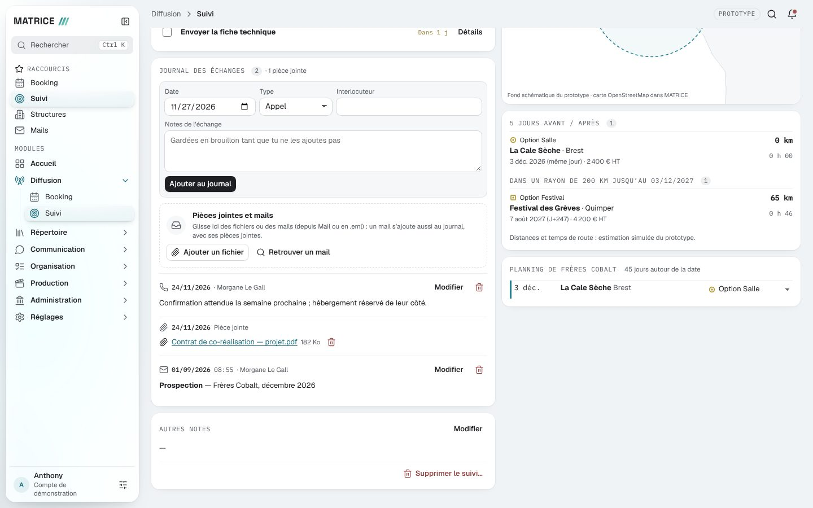 | 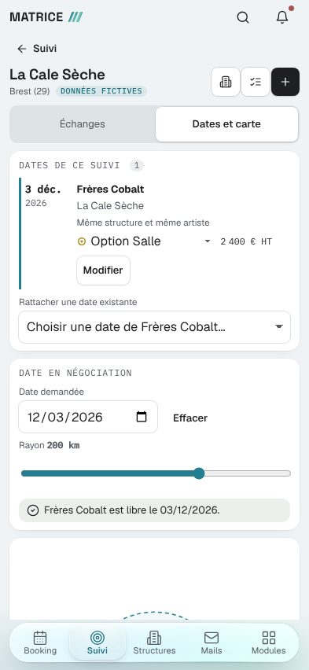 |

<details><summary>Texte de l’écran (Mac)</summary>

```text
Suivi
La Cale Sèche

Brest (29)
DONNÉES FICTIVES

Fiche structure
Nouvelle tâche
Poser une date
STRUCTURE ET LIEU
Structure
Choisir la structure…
Association Ondes Vives — Annecy
Festival des Marais — Niort
Festival des Tilleuls — Auch
La Cale Sèche — Brest
La Fabrique Sonore — Lille
La Vapeur — Dijon
Le Café des Rives — Angers
Le Grand Kiosque — Rennes
Le Hangar Bleu — Nantes
Le Moulin — Besançon
Le Préau — Tours
Le Rocher — Marseille
Opéra de Limoges — Limoges
Rencontres du Littoral — Sète
Salle Paul-Verdier — Lyon
Scène des Remparts — Vannes
Théâtre du Rempart — Dijon
Ville de Poitiers — service culture — Poitiers
Contacts de la structure
Morgane Le Gall
Programmation
Yann Kerhervé
Régie
Contact
Lieu du concert (si différent de la structure)

Sans lieu choisi, la carte part de la structure.

Frères Cobalt
Statut du suivi
Mail envoyé
Intérêt
Option
Confirmé
Clos
Dernier échange : 24/11/2026

Prospection envoyée le 01/09/2026
Relance

RÉSUMÉ DES ÉCHANGES
Mettre à jour avec l’IA
Modifier
Copier pour ChatGPT
Contexte : Morgane Le Gall.
Date : 3 décembre 2026 en option.
Offre financière : co-réalisation, minimum garanti 2 400 € HT.
Accueil : catering et hébergement pris en charge.
Prochaine action : confirmation attendue.
TÂCHES 1
Nouvelle tâche
Marquer « Envoyer la fiche technique » comme faite
Envoyer la fiche technique
Dans 1 j
Détails
JOURNAL DES ÉCHANGES 2· 1 pièce jointe
Date
Type
Appel
Mail
RDV
Note
Interlocuteur
Notes de l’échange
Ajouter au journal
Pièces jointes et mails
Glisse ici des fichiers ou des mails (depuis Mail ou en .eml) : un mail s’ajoute aussi au journal, avec ses pièces jointes.
Ajouter un fichier
Retrouver un mail
24/11/2026
· Morgane Le Gall
Modifier

Confirmation attendue la semaine prochaine ; hébergement réservé de leur côté.

24/11/2026
Pièce jointe

Contrat de co-réalisation — projet.pdf
182 Ko

01/09/2026
08:55
· Morgane Le Gall
Modifier

Prospection — Frères Cobalt, décembre 2026

AUTRES NOTES
Modifier

—

Supprimer le suivi…
DATES DE CE SUIVI 1
3 déc.
2026
Frères Cobalt
La Cale Sèche
Même structure et même artiste
Intérêt Festival
Option Festival
Confirmée Festival
Intérêt Salle
Option Salle
Confirmée Salle
Option Artiste
Confirmée Artiste
Annulée
Sans Suite
Sans statut
2 400 € HT
Modifier
Rattacher une date existante
Choisir une date de Frères Cobalt…
20/03/2026 · Le Grand Kiosque · Frères Cobalt · Confirmée Salle
18/07/2026 · Festival des Marais · Frères Cobalt · Confirmée Festival
19/07/2026 · Les Nuits de l’Estuaire · Frères Cobalt · Confirmée Festival
06/02/2027 · La Fabrique Sonore · Frères Cobalt · Confirmée Salle
07/02/2027 · Le 106 · Frères Cobalt · Option Salle
07/08/2027 · Festival des Grèves · Frères Cobalt · Option Festival
DATE EN NÉGOCIATION
Date demandée
Effacer
Rayon 200 km

Frères Cobalt est libre le 03/12/2026.

Fond schématique du prototype · carte OpenStreetMap dans MATRICE
5 JOURS AVANT / APRÈS 1
Option Salle
La Cale Sèche · Brest
3 déc. 2026 (même jour) · 2 400 € HT
0 km
0 h 00
DANS UN RAYON DE 200 KM JUSQU’AU 03/12/2027 1
Option Festival
Festival des Grèves · Quimper
7 août 2027 (J+247) · 4 200 € HT
65 km
0 h 46

Distances et temps de route : estimation simulée du prototype.

PLANNING DE FRÈRES COBALT 45 jours autour de la date
3 déc.
La Cale Sèche Brest
Intérêt Festival
Option Festival
Confirmée Festival
Intérêt Salle
Option Salle
Confirmée Salle
Option Artiste
Confirmée Artiste
Annulée
Sans Suite
Sans statut
```
</details>

<a id="09-preferences"></a>
## Préférences

| Mac | iPhone |
|---|---|
| 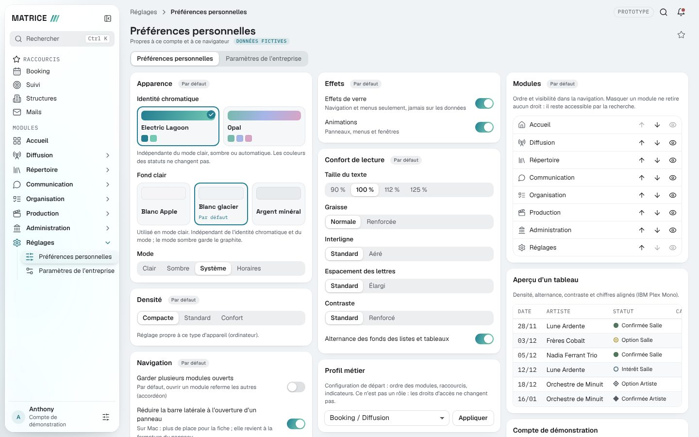 | 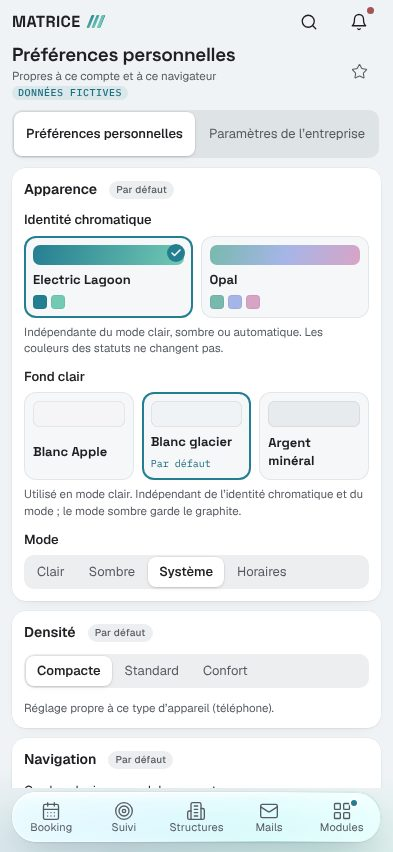 |

<details><summary>Texte de l’écran (Mac)</summary>

```text
Préférences personnelles

Propres à ce compte et à ce navigateur
DONNÉES FICTIVES

Préférences personnelles
Paramètres de l’entreprise
Apparence
Par défaut
Identité chromatique
Electric Lagoon
Opal

Indépendante du mode clair, sombre ou automatique. Les couleurs des statuts ne changent pas.

Fond clair
Blanc Apple
Blanc glacier
Par défaut
Argent minéral

Utilisé en mode clair. Indépendant de l’identité chromatique et du mode ; le mode sombre garde le graphite.

Mode
Clair
Sombre
Système
Horaires
Densité
Par défaut
Compacte
Standard
Confort

Réglage propre à ce type d’appareil (ordinateur).

Navigation
Par défaut
Garder plusieurs modules ouverts
Par défaut, ouvrir un module referme les autres (accordéon)
Réduire la barre latérale à l’ouverture d’un panneau
Sur Mac : plus de place pour la fiche ; elle revient à la fermeture du panneau
Tableaux
Par défaut
Booking — regroupement par défaut
Mois
Artiste
Artiste puis mois
Mois puis artiste
Un autre regroupement peut être choisi ponctuellement dans Booking
Suivi — tri par défaut
Dernière modification (plus récente d’abord)
Dernière modification (plus ancienne d’abord)
Dernier échange (plus récent d’abord)
Dernier échange (plus ancien d’abord)
Date de création (plus récente d’abord)
Date de création (plus ancienne d’abord)
Structure (Z → A)
Structure (A → Z)
Artiste (Z → A)
Artiste (A → Z)
Statut (du dernier au premier stade)
Statut (du premier au dernier stade)
Un autre tri peut être choisi ponctuellement dans Suivi
Suivi — afficher les textes en entier
Artistes et résumés sur plusieurs lignes au lieu d’être tronqués
Effets
Par défaut
Effets de verre
Navigation et menus seulement, jamais sur les données
Animations
Panneaux, menus et fenêtres
Confort de lecture
Par défaut
Taille du texte
90 %
100 %
112 %
125 %
Graisse
Normale
Renforcée
Interligne
Standard
Aéré
Espacement des lettres
Standard
Élargi
Contraste
Standard
Renforcé
Alternance des fonds des listes et tableaux
Profil métier

Configuration de départ : ordre des modules, raccourcis, indicateurs. Ce n’est pas un rôle : les droits d’accès ne changent pas.

Booking / Diffusion
Production
Administration
Direction
Personnalisé
Appliquer
Raccourcis
Par défaut

En tête de la barre latérale ; les 4 premiers forment la barre du bas sur téléphone.

Booking
Diffusion
Suivi
Diffusion
Structures
Répertoire
Mails
Communication
Accueil › Tableau de bord
Production › Production
Production › Budgets
Production › Ticketing
Administration › Finances
Administration › Salariés
Répertoire › Projets
Répertoire › Contacts
Communication › Promotion & Marketing
Communication › Modèles de mails
Organisation › To Do
Réglages › Préférences personnelles
Réglages › Paramètres de l’entreprise
Ajouter
Modules
Par défaut

Ordre et visibilité dans la navigation. Masquer un module ne retire aucun droit : il reste accessible par la recherche.

Accueil
Diffusion
Répertoire
Communication
Organisation
Production
Administration
Réglages
Aperçu d’un tableau

Densité, alternance, contraste et chiffres alignés (IBM Plex Mono).

DATE	ARTISTE	STATUT	CACHET HT
28/11	Lune Ardente	
Confirmée Salle
	3 200 €
03/12	Frères Cobalt	
Option Salle
	2 400 €
05/12	Nadia Ferrant Trio	
Confirmée Salle
	4 100 €
12/12	Lune Ardente	
Intérêt Salle
	2 800 €
18/12	Orchestre de Minuit	
Option Artiste
	—
16/01	Orchestre de Minuit	
Confirmée Artiste
	—
Compte de démonstration
Titulaire de la boîte Mails
Décoché : onglet Mails et bloc Messages masqués (A8). Le contrôle réel reste sur le serveur.
Paramètres par défaut

Revient au profil Booking / Diffusion et aux réglages d’origine.

Restaurer les paramètres par défaut
Représentation des statuts (A4)

Forme = type (carré : festival, rond : salle, losange : artiste) · remplissage = étape (contour : intérêt, point : option, plein : confirmée) · couleur fonctionnelle en complément · libellé toujours affiché.

Intérêt Festival
Option Festival
Confirmée Festival
Intérêt Salle
Option Salle
Confirmée Salle
Option Artiste
Confirmée Artiste
Annulée
Sans Suite
Sans statut

MARQUEURS DE CARTE (APERÇU)

Intérêt Festival
Option Festival
Confirmée Festival
Intérêt Salle
Option Salle
Confirmée Salle
Option Artiste
Confirmée Artiste
Annulée
Sans Suite
Sans statut
```
</details>
